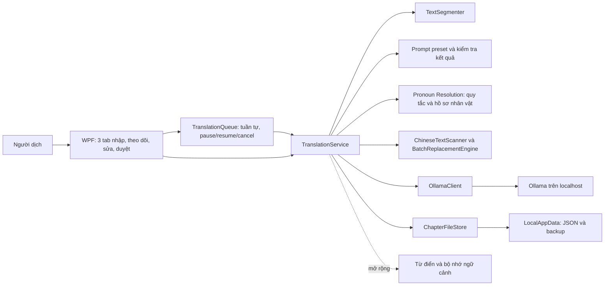

# Kiến trúc prototype

## Project Core và Project Workspace

`Core/Projects` là lớp sở hữu dữ liệu bộ truyện:

- `ProjectManifest` là nội dung có phiên bản của `.qtproj`; envelope kèm SHA-256 phát hiện tệp hỏng và giữ `.bak` của lần ghi nguyên tử trước.
- `ProjectRepository` tạo/mở dự án, liên kết `ProjectId` và số chương vào `ChapterDocument`, cập nhật thống kê, đổi tên/nhân bản, xóa mềm vào `History/Deleted` và phục hồi. Repository từ chối đường dẫn tuyệt đối, `..`, ID/số chương trùng và tệp chương mồ côi có cùng ID để tránh ghi đè.
- `ProjectSettingsStore` lưu cấu hình dịch, glossary, context và export trong thư mục dự án. `PromptPresetStore`, `ReaderPreferencesStore` và `CharacterProjectStore` được WPF trỏ vào đường dẫn của dự án đang mở. Data QuickTranslator truyền thống vẫn là thiết lập ứng dụng dùng chung và chỉ đọc.
- `ProjectLibraryStore` chỉ giữ shortcut gần đây trong LocalAppData. Xóa shortcut không đụng vào dự án; dự án di chuyển có thể được định vị lại bằng Project ID.
- `ProjectBackupService` tạo ZIP không chứa cache/backup lồng nhau, đọc mọi entry để kiểm chứng, chặn Zip Slip và chỉ khôi phục vào thư mục mới.
- `LegacyProjectImporter` quét các tệp `.qtaie.json`, sao lưu nguồn trước, nhập các chương đã chọn, xác minh nguyên văn/segment/lịch sử và hoàn tác manifest cùng tệp mới nếu có lỗi.

WPF chỉ giữ một `ProjectSession` hoạt động. Chuyển dự án hoặc chương gọi pause an toàn của `TranslationQueue`, chờ request hiện tại, lưu chapter/manifest/các store theo dự án rồi mới thay service. Sidebar đọc từ manifest, còn dữ liệu biên tập thật vẫn là `ChapterDocument`; Reader, Editor bốn ô, Batch Replace và Character Pronoun Manager không có bản sao riêng.

Book Builder chưa có trong repository ở thời điểm triển khai. Điểm tích hợp dự kiến là `ProjectSession.Manifest.Chapters` đã sắp theo `Number` và `ProjectRepository.LoadChapterAsync`; module tương lai phải dùng hai API này thay vì quét thư mục hoặc tạo database thứ hai.

## Ranh giới trách nhiệm

- **Core/Models**: chương, đoạn, trạng thái, bản AI/chuẩn hóa/bản sửa, hồ sơ nhân vật theo Project ID, lần dịch, bản duyệt, snapshot preset và checkpoint hàng đợi.
- **Core/Segmentation**: Unicode, ranh giới đoạn/câu/lời thoại, vị trí UTF-16, ID từ hash và khôi phục nguyên văn.
- **Core/Translation**: hàng đợi tuần tự, pause/resume/cancel/retry, prompt preset, local HTTP, phân giải xưng hô bằng quy tắc, cảnh báo chất lượng, ghép/xuất và điều phối duyệt/lưu. Không biết control WPF hoặc dùng GPU trực tiếp.
- **Core/TextCleaning**: quét CJK theo `Rune`, lập catalog ánh xạ, preview khớp dài nhất, áp dụng/hoàn tác revision và điều phối backup nhiều chương. Không gọi Ollama và không sửa source/AI gốc.
- **Core/Persistence**: schema, checksum, kiểm tra nguyên văn, tệp tạm/replace/backup và đọc phục hồi.
- **Wpf**: ba tab bản dịch chương, phân đoạn và thiết lập; clipboard/tệp, hiển thị tiến độ, nhịp tự lưu và đóng cửa sổ. Chưa dùng framework MVVM để giữ ứng dụng nhỏ; quy tắc nghiệp vụ vẫn nằm trong Core.
- **Tests**: xUnit, `HttpMessageHandler` giả lập và dữ liệu nhân tạo. Không kết nối GPU/model hay dùng truyện riêng tư.

## Các nguyên tắc giữ dữ liệu

`OriginalText` luôn giữ chuỗi nhập, `SourceText` mỗi đoạn là một lát nguyên chuỗi đó. `StartUtf16` phục vụ truy vết; không dùng để cắt đôi ký tự. Số thứ tự bắt đầu từ 1. ID đoạn dựa trên ID chương/vị trí/nội dung bằng SHA-256, lấy 128 bit; không dùng làm bằng chứng mật mã về tính đúng của bản dịch.

Mỗi lần gọi tạo một `TranslationAttempt`: ID, thời điểm, model/options, phiên bản prompt, prompt đầy đủ, kết quả, outcome, lỗi/cảnh báo, token/thời gian. Gọi lại thêm attempt, không xóa bản cũ. `UserDraft` và `DraftRevision` giữ bản người dùng đang sửa riêng; AI không gán vào trường này. `ApprovalRecord` lưu văn bản duyệt và revision tại thời điểm duyệt. Chỉ thao tác người dùng được đặt `Approved`; sửa hoặc dịch lại đưa về `AwaitingReview`. Lần lỗi/hủy vẫn có lịch sử.

`TranslationService` sao chụp dữ liệu trước khi trả cho UI, dùng khóa riêng để bảo vệ sửa trạng thái. `TranslationQueue` là nơi duy nhất tự chuyển đoạn và vẫn dùng semaphore dịch để bảo đảm tối đa một request. Hàng đợi lưu checkpoint trước request và sau mỗi kết quả; trạng thái duyệt không chặn đoạn kế tiếp. Đoạn có bản sửa/duyệt được bảo vệ khỏi auto-translate. Semaphore lưu lấy snapshot sau khi vào khóa, tránh một lần ghi chậm đè bản sửa mới. Nếu lưu trước API thất bại, không gửi chương; nếu lưu sau API thất bại, kết quả và nháp còn trong bộ nhớ để người dùng thử lưu.

## Character Pronoun Manager

`CharacterProject` giữ Project ID, tên bộ truyện và các `CharacterProfile`. Hồ sơ có ID ổn định, tên Trung/Việt đã xác nhận, bí danh, giới tính, quan hệ, đại từ chính/phụ, danh sách cần tránh, ghi chú và cờ bật. Snapshot nằm trong chương; tệp `.characters.json` riêng có checksum dùng để chuyển hồ sơ giữa các chương cùng truyện. Ánh xạ tên Trung–Việt từ hồ sơ được hợp nhất với glossary, không suy tên Trung từ phiên âm.

`PronounResolutionEngine` quét theo câu và vùng lời thoại. Một thay đổi chỉ được coi là an toàn khi đại từ thuộc danh sách cần tránh, ở ngoài lời thoại/danh xưng gia đình, và đúng một nhân vật phù hợp có tên rõ trong câu hiện tại hoặc hai câu gần nhất. Nhiều nhân vật, thiếu tiền ngữ và đoạn đã sửa/duyệt tạo cảnh báo hoặc trạng thái bảo vệ. Không dùng Find & Replace toàn văn bản, phần trăm tin cậy tùy ý hoặc lượt gọi AI thứ hai.

`TranslationAttempt.AiText` luôn giữ đầu ra Ollama. `TranslationSegment.NormalizedText` và `PronounNormalizationRun` giữ phiên bản sau xử lý, vị trí thay đổi, lý do, batch và dữ liệu hoàn tác. `EditableText` ưu tiên bản người dùng, sau đó bản chuẩn hóa, rồi bản AI gốc. Hoàn tác chỉ chạy khi không có sửa/duyệt mới và nội dung vẫn khớp bản đã áp dụng. Cảnh báo đại từ nhập nhằng được ghép vào kiểm tra chất lượng nhưng không chặn queue và không tự duyệt.

## Chinese Text Cleaner và Batch Replace

`ChineseTextScanner` duyệt Unicode bằng `Rune`, nhận diện Unified Ideographs, Compatibility Ideographs và các extension A–I liên quan. Scanner giữ offset/độ dài UTF-16 để WPF mở đúng `TextBox`, gom các rune Hán liền nhau thành cụm và đối chiếu catalog xác nhận. Chuỗi người dùng đánh dấu giữ nguyên chỉ bị loại khỏi cảnh báo, không bị xóa khỏi dữ liệu.

`ReplacementRuleCatalog` phân biệt quy tắc nhập trực tiếp, Glossary, CharacterProfile và gợi ý Data truyền thống. Nhiều giá trị cho cùng khóa tạo conflict; quy tắc trực tiếp là quyết định tường minh của người dùng trong lần preview. `BatchReplacementEngine` quét trái sang phải, chọn khóa dài nhất ở mỗi vị trí và không dùng word boundary Latin. Preview chụp toàn bộ `EditableText` cùng `DraftRevision`; apply bị từ chối nếu nội dung đã đổi hoặc các vùng chồng lấn.

Mỗi lần áp dụng tạo `BatchReplacementRun` và `BatchReplacementSegmentRevision`. Revision giữ văn bản trước/sau, trạng thái, nguồn nháp và danh sách thay đổi. Bản đã sửa/duyệt cần xác nhận riêng, sau thay thế trở lại chờ duyệt nhưng approval cũ và AI attempts vẫn còn. Hoàn tác chỉ thành công khi revision/nội dung hiện tại vẫn đúng bản vừa áp dụng.

`BatchProjectReplacementService` chỉ nạp chương có cùng Character Project ID. Trước khi ghi nhiều chương, `ChapterFileStore` kiểm tra checksum rồi sao chép file chính vào `BatchBackups`; mỗi chương vẫn được ghi bằng temp/flush/replace hiện có. Báo cáo trả riêng thành công/lỗi vì hệ thống file không có giao dịch nguyên tử xuyên nhiều file.

Trong queue, output AI được giữ nguyên trong `TranslationAttempt.AiText`. Nếu tùy chọn bật, chỉ quy tắc xác nhận không xung đột từ snapshot chương lúc bắt đầu request được áp dụng vào `NormalizedText`; phần Hán chưa biết thêm cảnh báo `UntranslatedChinese`. Bước này không chạy lượt Ollama khác, không áp dụng lên `UserDraft` được bảo vệ và không chặn segment kế tiếp.

Lần mở lại đánh dấu `Translating`/`InProgress` thành lỗi/`Interrupted`; không tự gửi lại. Người dùng bấm Tiếp tục để hàng đợi bỏ qua phần đã hoàn tất. Thay ranh giới lưu toàn bộ đoạn cũ vào lịch sử, giữ nguyên phần không ảnh hưởng và yêu cầu xác nhận nếu đã có bản dịch. Lưu ra đĩa có checksum và backup nhưng không chống mọi sự cố phần cứng. Checksum nhằm phát hiện hỏng/sửa file, không mã hóa dữ liệu hay xác nhận tác giả.

## Reader density và thao tác vùng chọn

`ChapterTranslationComposer` là quy tắc ghép segment dùng chung cho Reader và TXT Export; vì vậy hai đường luôn có cùng văn bản và offset. `ReaderDocumentComposer` bổ sung ánh xạ segment cùng trạng thái đọc trên output canonical đó. `ReaderDisplayLayout` chỉ tạo danh sách khoảng ký tự cần vẽ; tùy chọn thu gọn paragraph rỗng không sửa `ReaderDocument.Text` hay dữ liệu chương. `ReaderPreferencesStore` lưu density, giãn dòng, khoảng cách đoạn, lề, chiều rộng, trạng thái mục lục và vị trí chapter/segment/offset bằng ghi tệp nguyên tử riêng.

`SourceContextActions` kiểm tra vùng chọn và tìm hồ sơ/vị trí ở Core. WPF gắn cùng context menu vào `ChapterInput` và `SourceText`, chụp/phục hồi selection khi chuột phải. Thêm nhân vật dùng `CharacterProject`/`CharacterProjectStore`; glossary dùng `ConfirmedTerms` trong chương; dịch riêng dùng `TranslationPromptBuilder` và `OllamaClient`. Không có cơ sở dữ liệu phụ hoặc đường ghi nào vào bản dịch người dùng.

## Engine QuickTranslator truyền thống và Editor bốn ô

`TraditionalDataLoader` đọc `Dictionaries.ini` và các file Hán Việt, VietPhrase, Names, Pronouns, LuatNhan, Mark bằng UTF-8 nghiêm ngặt. Loader giữ quy tắc dòng đầu tiên khi khóa lặp trong cùng file, sau đó phủ `VietPhraseAddition` lên VietPhrase và `NamesPhu` lên Names theo hành vi đã đối chiếu. Snapshot chỉ đọc kết hợp Names trước VietPhrase; file liên quan bị thiếu được báo theo mức lỗi/cảnh báo, không làm hỏng chức năng AI.

`TraditionalTranslator` là phần chuyển thích nghi có kiểm soát từ `ChineseToHanViet` và `ChineseToVietPhraseOneMeaning` của TranslatorEngine cũ. Mỗi lần quét tạo đồng thời văn bản đích và `AlignmentSpan` source/target. `SelectionAlignment` luôn quy lựa chọn về offset nguyên văn rồi chiếu sang hai ô còn lại, không tìm chuỗi và không nhầm các cụm lặp. Ký tự ngoài BMP được xử lý theo `Rune`; dấu câu/xuống dòng có span riêng.

`TraditionalTranslationService` nạp Data bất đồng bộ, giữ một snapshot bất biến và cache LRU theo fingerprint Data, tùy chọn cùng SHA-256 nguyên văn. WPF chỉ dịch từ điển cho segment đang chọn; thao tác bôi đen chỉ đọc bảng alignment đã có. `TraditionalEditorPreferencesStore` lưu đường dẫn Data bằng ghi file nguyên tử ngoài dữ liệu chương.

`MainWindow.Traditional.cs` điều phối bốn ô. `SelectionChanged` của ô đang thao tác chỉ tạo `SelectionProjection`; không gọi `Select()` lên hai ô đích. `TextBoxRangeHighlightAdorner` vẽ các hình chữ nhật xanh theo offset bằng `GetRectFromCharacterIndex`, không nhận hit-test và không phụ thuộc focus. Adorner cập nhật khi cuộn, đổi kích thước hoặc đổi text; `AdornerDecorator` bao quanh vùng tab để luôn có lớp vẽ. Khi đổi segment, đổi Data, mất selection hoặc alignment hết hạn, highlight bị xóa. Ô AI dùng nguyên luồng `TranslationService`, nháp, duyệt và lịch sử hiện có. Pane 2×2 dùng GridSplitter và có trạng thái ẩn/phóng lớn riêng. Reader Mode không tham gia luồng này.

`AlignmentDiagnosticsLogger` là chẩn đoán tùy chọn. Nó chỉ ghi timestamp, ID segment, SHA-256 phiên bản source, pane gốc, các khoảng source/Hán Việt/VP và trạng thái ánh xạ. Nội dung được giữ cục bộ, mặc định tắt và không tham gia dữ liệu chương.

## Ollama và prompt

Một yêu cầu dịch có GET `/api/tags` để kiểm tra model local rồi một POST `/api/chat` với một message `user`, `stream:false`, `temperature`, `num_ctx`, `num_predict`. Mỗi client chỉ có một lượt đang xử lý; timeout bao gồm cả kiểm tra model và đọc phản hồi. Transport production không dùng proxy/redirect. Không chọn model cloud, không tải model tự động, không dùng cloud fallback. Việc tắt cloud ở Ollama và thử khi ngắt Internet vẫn cần thực hiện trên máy chạy.

`IGlossaryProvider` và `IContextMemory` là điểm mở rộng cho dữ liệu tham khảo. Thuật ngữ/xưng hô do người dùng xác nhận, ghi chú ngắn và một phần bản dịch đã duyệt có thể được đưa vào prompt; không âm thầm gửi cả chương. Mỗi attempt giữ snapshot preset và model options để lịch sử có thể kiểm tra lại. Module không nối hoặc sửa engine gốc.

Kiểm tra chất lượng dùng dấu hiệu, không so sánh ngữ nghĩa bằng model thứ hai. Kết quả rỗng là lỗi; kết thúc vì giới hạn token, lặp bất thường, ngắn hơn nhiều, thiếu đoạn hoặc còn chữ Hán là cảnh báo. Người dùng phải đọc và duyệt; không có trạng thái “AI xác nhận đúng”.
